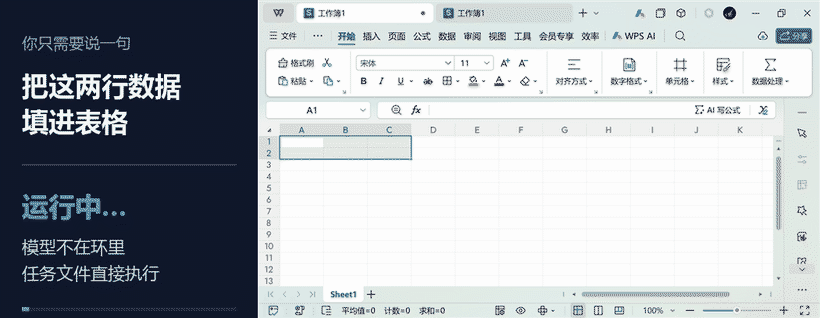
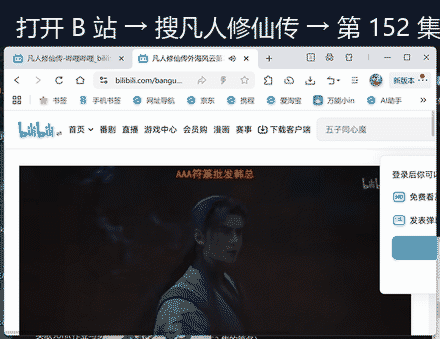
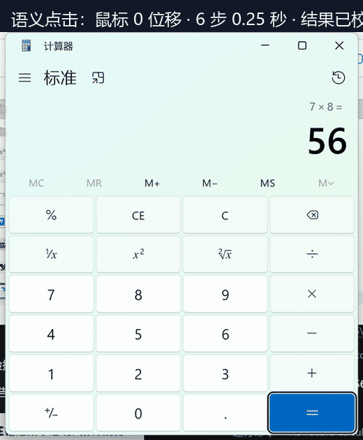
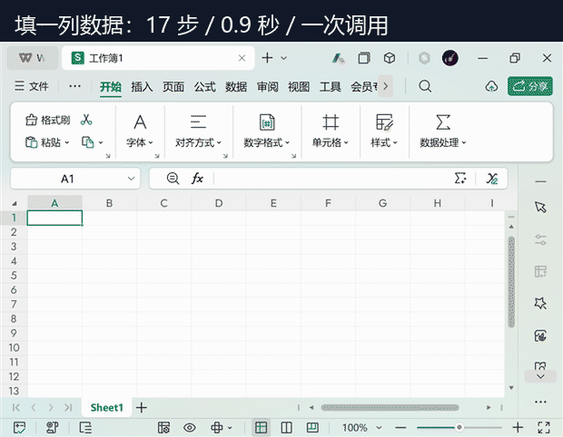

<div align="center">


# dsh-gui-control

**给 DeepSeek Harness 的 Windows 桌面操控：不是「帮我点一下」,而是「以后这个活都交给你」。**

<p>
  <a href="https://www.npmjs.com/package/dsh-gui-control"></a>
  
  
  <a href="https://github.com/topics/dsh-plugin"></a>
</p>

[中文说明](#中文说明) · [English](#english)

</div>

---

<div align="center">



</div>

---

## 中文说明

### 它和别的桌面 Agent 有什么不同

大多数桌面自动化解决的是**一次性操作**：看一眼屏幕、点一下、再看一眼。这个插件多做一层——**把一套动作固化成任务文件**，跑的时候模型完全不参与。

| | 常见做法 | dsh-gui-control |
|---|---|---|
| 感知 | 截图 → 模型猜坐标 | **无障碍树优先**，按控件名定位；树不可用时才截图 |
| 一次任务的往返 | 每步一次模型调用 | 一次调用跑完整个任务文件 |
| 失败之后 | 不知道点没点上 | **投递判定**：没发出去 / 可能发出去了 / 已验证 |
| 重复执行 | 每次重跑一遍 | 任务文件可复用，带条件等待与重试 |

### 演示

**① 打开 B 站 → 搜番剧 → 播到指定集数**



**② 语义点击：鼠标位移 0 像素**（直接调用控件的 Invoke，鼠标不动、窗口在后台也能点）



**③ 填一列数据**（17 步 / 0.9 秒 / 一次调用）



### 安装

```bash
dsh plugin add dsh-gui-control
```

或从源码：

```bash
dsh plugin add seetown/dsh-gui-control
```

要求：Windows 10 1809+、PowerShell 5.1、DeepSeek Harness 0.1.5-rc.2 ~ 0.2.x。装完不需要重启。

### 三个工具

| 工具 | 作用 |
|---|---|
| `gui_snapshot` | 读窗口的无障碍树（文本，精确、便宜、与位置无关），或带屏幕坐标刻度尺的截图 |
| `gui_act` | 执行一个动作，带身份校验和投递判定 |
| `gui_task` | 跑声明式任务文件：一次调用完成多步，带条件、重试、风险闸门 |

```
gui_snapshot { window: "Notepad", mode: "tree" }
→ Butto 关闭标签页 / Docum 文本编辑器 / MenuI 文件 ...

gui_act { action: "click_text", window: "Notepad", text: "最大化" }
→ click ok via InvokePattern | verified: text appeared
```

**优先用 `click_text` 而不是坐标**：它按控件名定位，鼠标不动，窗口布局变了也不会点错。

### 任务文件

```json
{
  "name": "fill-sheet",
  "steps": [
    { "do": "activate", "win": "工作簿1" },
    { "do": "type", "text": "项目" },
    { "do": "key", "key": "tab" },
    { "do": "type", "text": "金额" },
    { "do": "key", "key": "enter",
      "until": { "op": "pathexists", "text": "C:\\out\\report.xlsx" }, "untilTimeout": 10 }
  ]
}
```

每步字段：`do` + 该动作参数，外加 `until`（轮询到条件成立才算过）、`untilTimeout`、`retry`、`risk`。

- `risk: "high"` 的步骤默认**拒绝执行**，必须显式 `confirm: true`
- `dryRun: true` 只返回计划，不碰桌面

### 投递语义

每个动作返回三选一：

| 判定 | 含义 | 能否重试 |
|---|---|---|
| `not_delivered` | 什么都没发出去（派发前就被拒） | ✅ 安全 |
| `delivered_unverified` | 发出去了，效果未确认 | ❌ 不能盲目重放 |
| `delivered_verified` | 发出去了，且后置条件验证通过 | ❌ |

这一条决定了「发消息 / 删文件 / 提交表单」这类不可逆操作是否安全。

### 安全

- 只监听 `127.0.0.1:38471`，不对外暴露
- 密码字段一律输出 `<redacted>`
- 高风险步骤需要显式确认
- 结果不明时**绝不自动重试**

> 这个插件能操控整台机器的鼠标键盘。装之前请知情，只在可信环境使用。

### 实测数据

| 操作 | 耗时 |
|---|---|
| 单步动作（常驻进程） | 10.8 ms |
| 语义点击（UIA 树） | 26–34 ms |
| 紧凑树读取 | 86 ms，865 字符（比完整 dump 省 88%） |
| 7 步任务（含启动计算器） | 680 ms，一次调用 |
| 桌面建 3 个文件夹 | 3.45 s，3/3 成功 |
| WPS 填 2×3 表格 | 0.9 s，17 步 |

首次调用会预热常驻进程（约 1 秒），之后每个动作是一次 loopback 往返。

### 已知限制

- **仅 Windows**（Win32 + UI Automation）
- 需要 PowerShell 5.1
- 画布类应用（WPS 表格、游戏、自绘列表）没有无障碍树，只能截图 + OCR，准确率下降
- 网页任务目前基于截图；CDP 通道已实现但尚未接入工具

### Roadmap

- [ ] 截图自动编号（Set-of-Marks），把坐标估计降级成编号分类
- [ ] 接入 CDP：网页任务按选择器操作，而不是按坐标
- [ ] 任务库与意图路由：一句话命中现成任务
- [ ] macOS / Linux 适配

---

## English

**Windows desktop control for DeepSeek Harness.** Not "click that button for me" — "this job is yours from now on."

Most desktop agents do one-off operations: look, click, look again. This one adds a layer underneath: **it turns a sequence into a task file** that runs with no model in the loop.

### What makes it different

| | Typical approach | dsh-gui-control |
|---|---|---|
| Perception | Screenshot, then the model guesses coordinates | **Accessibility tree first**, addressed by control name; screenshots only when no tree exists |
| Round trips per task | One model call per step | One call runs the whole task file |
| After a failure | Unknown whether it landed | **Delivery verdict**: not delivered / may have landed / verified |
| Repeating a flow | Replay it by hand | Task files are reusable, with conditions and retries |

### Install

```bash
dsh plugin add dsh-gui-control
```

Windows 10 1809+, PowerShell 5.1, DeepSeek Harness 0.1.5-rc.2 – 0.2.x. No restart needed.

### Three tools

| Tool | Purpose |
|---|---|
| `gui_snapshot` | Read a window's accessibility tree as text, or a screenshot with a screen-coordinate ruler |
| `gui_act` | One action, with an identity check and a delivery verdict |
| `gui_task` | Run a declarative task file: many steps in one call, with conditions, retries and a risk gate |

### Delivery semantics

| Verdict | Meaning | Retry |
|---|---|---|
| `not_delivered` | Nothing was sent | ✅ safe |
| `delivered_unverified` | Input may have landed, effect unconfirmed | ❌ never blind-retry |
| `delivered_verified` | Landed, and the post-condition held | ❌ |

That distinction is what makes "send a message / delete a file / submit a form" safe to automate.

### Security

Loopback-only (`127.0.0.1:38471`), password fields are redacted, high-risk steps require explicit confirmation, and an uncertain outcome is never retried automatically.

> This plugin drives the real mouse and keyboard of the whole machine. Install it knowingly, in a trusted environment.

### Limitations

Windows only; PowerShell 5.1 required; canvas-like apps (spreadsheets, games, self-drawn lists) expose no accessibility tree and fall back to screenshot + OCR with lower accuracy; web tasks currently use screenshots (the CDP path exists but is not wired into the tools yet).

---

<div align="center">

MIT © [seetown](https://github.com/seetown)

</div>
